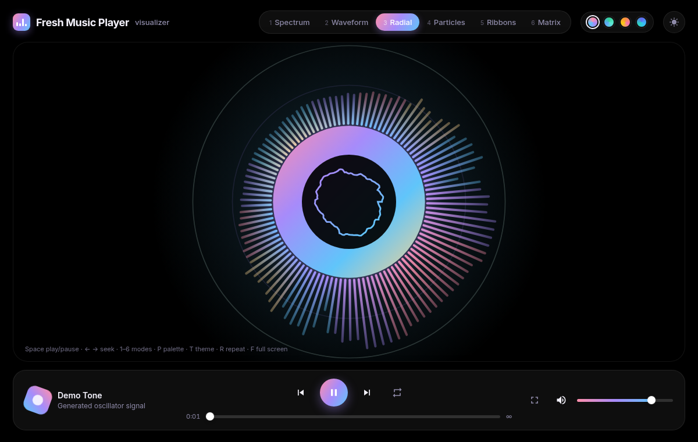
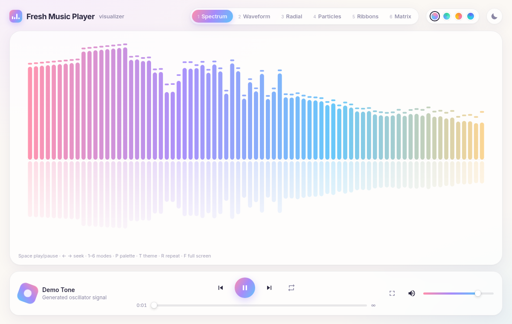
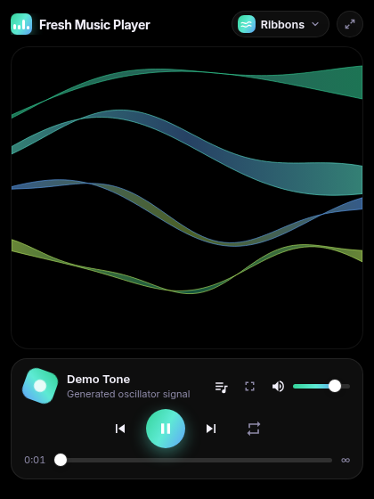

# Fresh Music Player

A native macOS music player for MP3 and WAV files that lives in your menu bar, with live audio visualizations.



<p>
  
  
</p>

## Features

- A menu bar icon that opens a compact mini player, plus a Dock icon and a full window you can drag around
- Six visualization modes: Spectrum, Waveform, Radial, Particles, Ribbons and Matrix
- Four color palettes (Blossom, Mint, Sunset, Ocean) and a light or black theme
- Full screen visualization
- Repeat off, repeat once, or repeat forever
- A playlist where you can drop in files and remove songs
- Open MP3 and WAV files straight from Finder

## Build

You need macOS 11 or later and the Xcode Command Line Tools (`xcode-select --install`).

```bash
cd mac
bash build.sh
open "Fresh Music Player.app"
```

To install it, copy `mac/Fresh Music Player.app` into `/Applications`.

## Keyboard shortcuts

| Key | Action |
| --- | --- |
| Space | Play or pause |
| N / B | Next or previous track |
| Left / Right | Seek 5 seconds (30 with Shift) |
| Up / Down | Volume |
| 1 to 6 | Visualization mode |
| P | Next palette |
| T | Light or black theme |
| R | Cycle repeat |
| F | Full screen |

## Layout

- `player.html` is the player UI, audio engine and visualizations (Web Audio and canvas).
- `mac/main.swift` is the native AppKit shell: the menu bar item, popover, window and file handling.
- `mac/build.sh` compiles with `swiftc` and assembles the `.app` bundle.
- `mac/icon.svg` is the app icon, which the build script renders to PNG.
